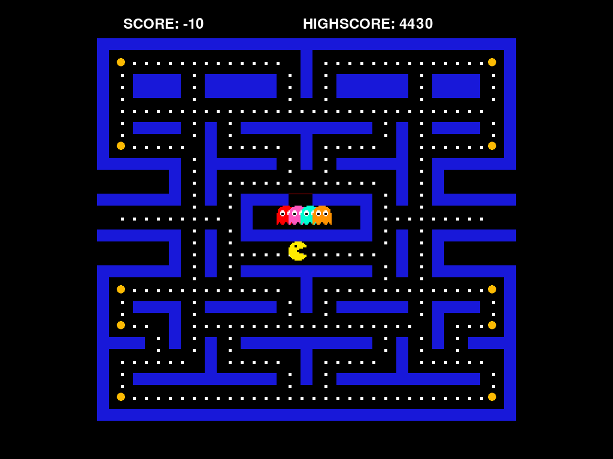

# PyPacman 教程网站更新说明

## 本次更新内容

### 1. 添加游戏运行截图

已成功捕获 6 张游戏运行截图，保存在 `docs/screenshots/` 目录：

- ✅ 游戏初始界面
- ✅ 游戏进行中（3 个时间点）
- ✅ 游戏结束画面

### 2. 更新教程网站 HTML

在 `docs/tutorial-site.html` 中添加了：

- **截图画廊组件**：响应式网格布局，支持悬停效果
- **项目概览章节**：添加 4 张截图展示游戏运行效果
- **架构设计章节**：添加 2 张截图对照代码与视觉效果
- **CSS 样式**：截图画廊、图片卡片、说明文字样式

### 3. 自动截图工具

创建了两个辅助脚本：

- `auto_screenshot.py` - 自动运行游戏并截图（无需手动操作）
- `capture_screenshots.py` - 手动截图模式（按 S 键截图）

## 文件清单

```
PyPacman/
├── docs/
│   ├── tutorial-site.html          # 教程网站（已更新，含截图）
│   ├── screenshots/                 # 截图目录（新增）
│   │   ├── 01_游戏初始界面.png
│   │   ├── 02_游戏进行中_2秒.png
│   │   ├── 03_游戏进行中_4秒.png
│   │   ├── 04_游戏进行中_6秒.png
│   │   ├── 05_游戏进行中_8秒.png
│   │   ├── 06_游戏结束画面.png
│   │   └── README.md               # 截图说明文档
│   ├── 01-按知识模块版.md
│   └── 02-按游戏功能螺旋版.md
├── auto_screenshot.py               # 自动截图脚本（新增）
└── capture_screenshots.py           # 手动截图脚本（新增）
```

## 使用方法

### 查看教程网站

直接在浏览器打开：

```bash
open docs/tutorial-site.html
```

或双击文件在浏览器中查看。

### 重新生成截图

如果需要更新截图（例如修改了游戏代码）：

```bash
# 激活虚拟环境
source .venv/bin/activate

# 自动截图（推荐）
python auto_screenshot.py

# 或手动截图
python capture_screenshots.py
```

### 发布为 Qoder Site

教程网站已准备好发布为 Qoder Site，供学生在线访问。

发布前检查：
- [x] 所有截图已生成
- [x] HTML 文件已更新
- [x] 截图路径正确（相对路径 `screenshots/...`）
- [x] 响应式布局已测试
- [x] 打印样式已优化

## 技术细节

### 截图参数

- 分辨率：560×620 像素
- 格式：PNG（无损）
- 自动截图间隔：2 秒
- 总运行时长：10 秒

### HTML 更新

- 新增 CSS 类：`.screenshot-gallery`, `.screenshot-item`
- 图片加载：使用 `loading="lazy"` 懒加载
- 响应式：桌面 4 列，平板 2 列，手机 1 列
- 交互：悬停时卡片上浮并增加阴影

### 文件路径

所有截图使用相对路径引用：
```html

```

这确保了发布到 Qoder Site 后路径仍然正确。

## 下一步建议

1. **预览效果**：在浏览器中打开 `docs/tutorial-site.html` 查看截图效果
2. **调整截图**：如果某些截图不够清晰，可以修改 `auto_screenshot.py` 的截图时机
3. **发布站点**：使用 Qoder Sites 发布教程网站
4. **学生反馈**：收集学生对截图和教程的反馈，进一步优化

## 故障排除

### 截图失败

如果截图脚本运行失败：

1. 检查 pygame 是否安装：`pip list | grep pygame`
2. 检查虚拟环境：`source .venv/bin/activate`
3. 检查显示环境：macOS 需要图形界面支持

### 图片不显示

如果 HTML 中图片不显示：

1. 检查截图文件是否存在：`ls docs/screenshots/`
2. 检查路径是否正确：HTML 中使用 `screenshots/...`（相对路径）
3. 检查浏览器控制台是否有 404 错误

### 样式异常

如果截图画廊样式异常：

1. 清除浏览器缓存
2. 检查 CSS 是否正确加载
3. 尝试在不同浏览器中打开

---

**更新时间**：2026-11-06  
**截图数量**：6 张  
**HTML 文件大小**：65 KB  
**状态**：✅ 已完成，可发布
